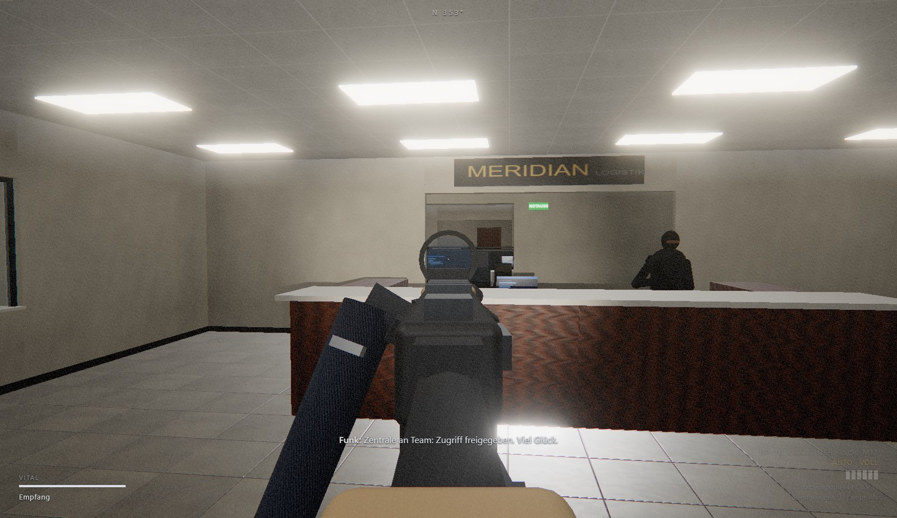
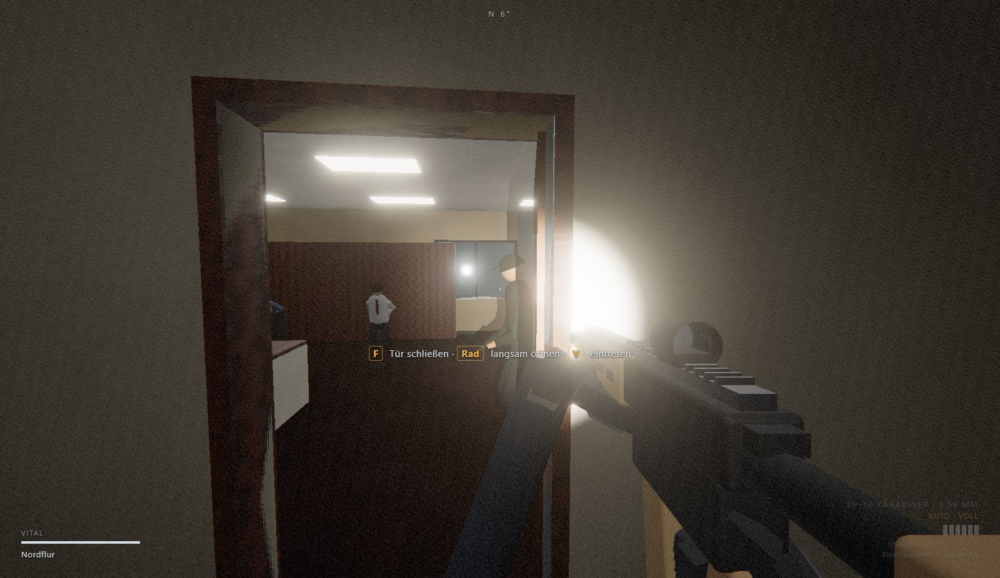
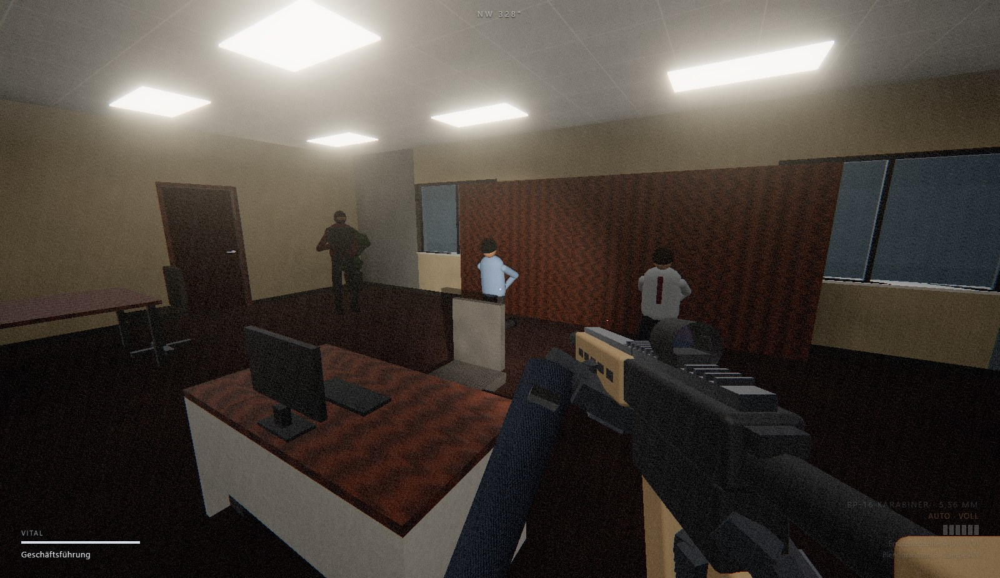
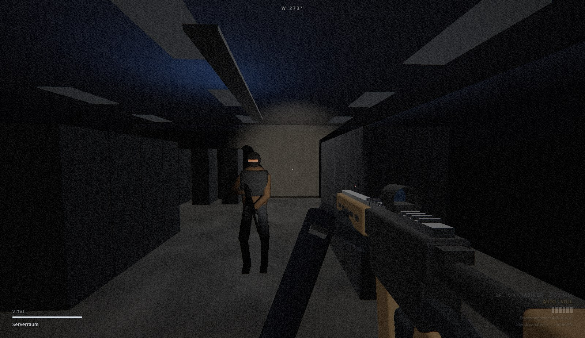
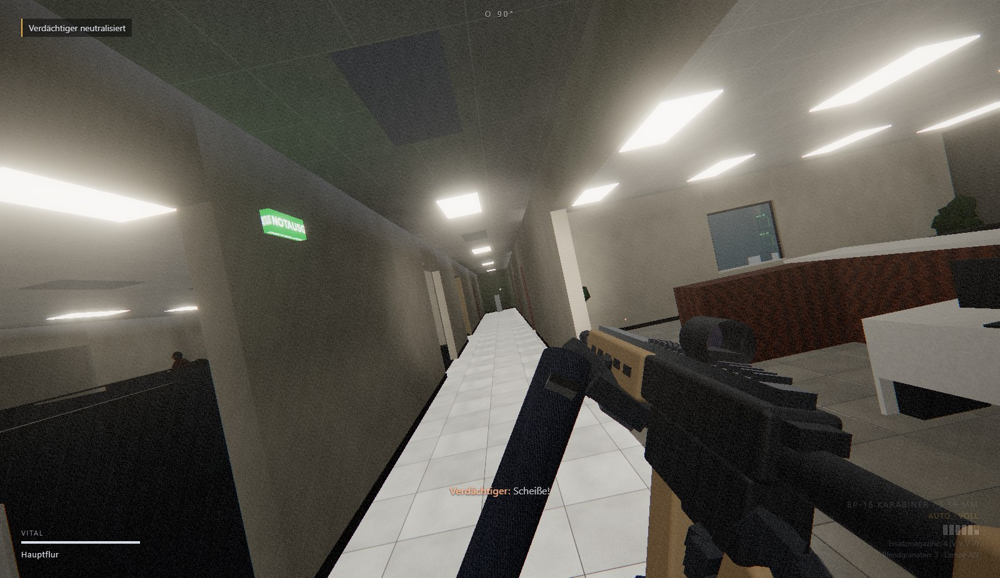
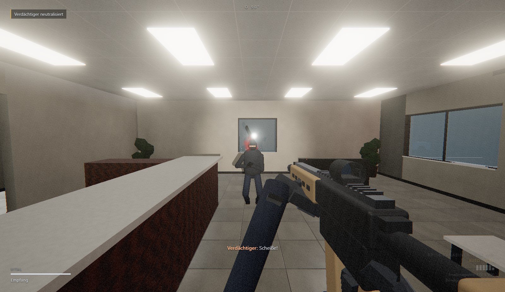
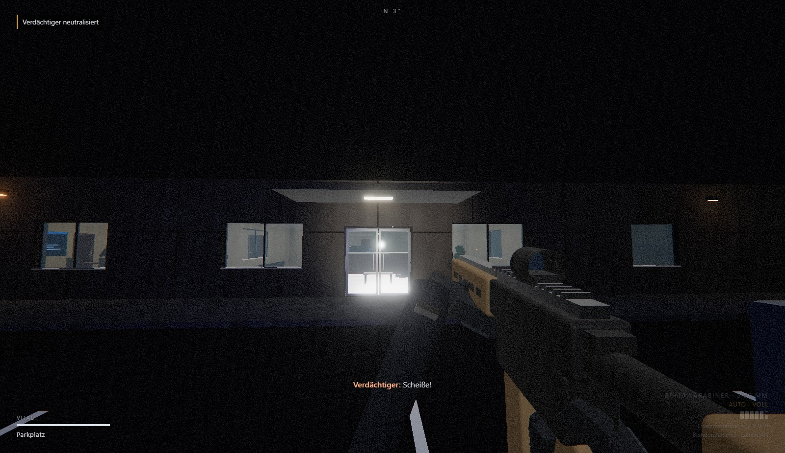

# Hotzone Breachpoint

Ein taktischer SWAT-Shooter für Windows. Langsam, methodisch, tödlich: Räume klären, Verdächtige anrufen und festnehmen, Geiseln befreien. Die Inspiration ist *Ready or Not*, alle Inhalte sind aber eigenständig.



## Download & Start (Windows)

1. Unter **[Releases](../../releases/latest)** die Datei `HotzoneBreachpoint-win64.zip` herunterladen.
2. Die ZIP-Datei entpacken.
3. `HotzoneBreachpoint.exe` starten.

> Die .exe ist nicht signiert. Windows SmartScreen zeigt deshalb beim ersten Start eventuell eine Warnung: **Weitere Informationen → Trotzdem ausführen**.

Es wird nichts installiert, nichts ins Internet gesendet und kein Browser benötigt. Das Spiel läuft in einem eigenen Fenster (F11 schaltet auf Vollbild).

## Der Einsatz: Operation Kalte Bilanz

Meridian Logistik GmbH, Verwaltungsgebäude, 02:40 Uhr. Eine bewaffnete Gruppe hat das Gebäude besetzt, im Ostflügel ist der Strom ausgefallen.

- **3 Geiseln** befreien (Geschäftsführung, Pausenraum)
- **Beweismittel** sichern (Laptop im Serverraum)
- **13 Verdächtige** festnehmen oder neutralisieren
- **2 Zivilisten** sichern

Die Karte ist ein ausladendes Bürogebäude mit 19 Räumen: Empfang, Sicherheitsbüro, Konferenzraum, Lager mit Seiteneingang, Großraumbüro mit Kabinen, Serverraum, Archiv, Geschäftsführung, zwei Längsflure und zwei Querdurchgänge. Dadurch gibt es mehrere Wege, Flanken und Hinterhalte. Draußen liegt ein nächtlicher Parkplatz mit Einsatzfahrzeugen.

| | |
|---|---|
|  |  |
|  |  |
|  |  |

## Features

**Gunplay**
- Karabiner (Auto/Einzel) und Pistole, Rotpunktvisier, echtes Zielen über die Visierlinie
- Rückstoß mit Federphysik, Rückstellung, Waffenschwanken, Atmen, Mündungsfeuer, das den Raum ausleuchtet
- Magazine werden einzeln verwaltet: Teilgefüllte Magazine gehen zurück in die Tasche, und angezeigt wird nur eine Schätzung (voll/gut/halb/wenig), keine exakte Zahl
- Taktisches Nachladen vs. Nachladen bei leerer Kammer (Verschlussfang), Hülsen mit Physik und Klang
- Durchschlag durch Trockenbau, Holztüren, Glas und Stellwände, aber nicht durch Beton
- Waffe senkt sich automatisch an Wänden (Low Ready)

**Bewegung**
- Lehnen links/rechts (Q/E) mit Kollisionsprüfung, Ducken, Schleichen, Sprinten mit Ausdauer
- Trägheit, Kopfwippen, Schritte je nach Boden (Teppich, Fliese, Beton); Lautstärke wird von der KI gehört

**Gegner-KI**
- Sichtkegel, Lichtverhältnisse (im Dunkeln ohne Lampe schwerer zu sehen), Hören von Schüssen, Schritten und Türen
- Reaktionszeit, Zielen wird mit der Zeit genauer, Unterdrückung durch Beschuss
- Deckungssuche, Abtauchen und Wiederauftauchen, seitliches Lehnen aus hoher Deckung, Winkel halten (Hinterhalt), Vorrücken je nach Aggressivität
- Teamkommunikation („Kontakt!“), Nachladen in Deckung, Flucht bei gebrochener Moral
- Aufgeben nach Anruf (F), abhängig von Moral, Verletzung, Überraschung und ob du auf sie zielst; manche **täuschen das Aufgeben nur vor** und ziehen eine versteckte Waffe, sobald du wegschaust
- Zivilisten verstecken sich und folgen Anweisungen; Geiseln sind gefesselt

**Ragdoll & Physik (Euphoria-Anmutung)**
- Verlet-Ragdoll mit „aktiven Muskeln“: Der Körper bleibt nach dem Treffer kurz angespannt, die Knie knicken ein, eine Hand greift an die Wunde, und die Arme fangen den Sturz ab
- Kopftreffer: sofort schlaff. Der Schwung der Bewegung bleibt erhalten, die Waffe fällt physikalisch zu Boden
- Blutspritzer an Wänden, Blutlachen, Treffer-Reaktionen bei Lebenden

**Taktik**
- Türen: öffnen/schließen, mit dem **Mausrad langsam aufschieben** zum Spähen, **eintreten** (V); wer dahinter steht, wird umgestoßen
- **Blendgranaten** (G): blenden und betäuben Gegner, dich selbst auch, wenn du hinsiehst (inklusive Tinnitus)
- Rules of Engagement: Wer auf Ergebene schießt, bekommt einen Regelverstoß. Am Ende gibt es eine Einsatzbewertung (S bis F)

**Grafik & Technik**
- Eigene vorberechnete Beleuchtung beim Laden (unter 1 s): Schatten pro Leuchte, weiche Schatten, Raumfüllung, Ecken-Abdunklung, Mondlicht durch Fenster
- Waffenlampe mit Echtzeit-Schatten, Bloom, Filmkorn, Vignette, Schadens- und Blendeffekte
- Alle Texturen, Modelle und Sounds werden **prozedural** im Code erzeugt, es gibt keine externen Assets
- Sprachausgabe über die Windows-Stimmen (deutsch), Untertitel
- Läuft auch auf schwächeren PCs: Qualitätsstufe *Niedrig* im Menü (geringere Auflösung, kleine Schattenkarte, ohne Bloom)

## Steuerung

| Taste | Aktion |
|---|---|
| WASD | Bewegen |
| Shift / Alt | Sprinten / Schleichen |
| Strg (halten) / C | Ducken |
| Q / E | Lehnen links / rechts |
| Linke / rechte Maustaste | Schießen / Zielen |
| R | Nachladen |
| B | Feuermodus |
| T | Waffenlampe |
| 1 / 2 | Karabiner / Pistole |
| G | Blendgranate |
| F (tippen) | Rufen („Polizei! Hände hoch!“) bzw. Tür öffnen/schließen |
| F (halten) | Festnehmen, Geisel befreien, Beweis sichern |
| Mausrad (an Tür) | Tür langsam öffnen |
| V | Tür eintreten |
| Tab | Einsatzziele |
| Esc | Pause |
| F11 / F3 | Vollbild / FPS-Anzeige |

## Selbst bauen

Voraussetzung: Node.js 20+.

```bash
npm install
npm run dev      # Entwicklung im Browser unter http://localhost:5180
npm start        # als Desktop-App starten
npm run pack     # Windows-Build nach release/
```

Aufbau: `src/world` (Karte, Kollision, Licht-Baking, Navigation), `src/actors` (Skelett/IK, Ragdoll, KI), `src/player` (Steuerung, Waffenmodell), `src/fx` (Effekte, Nachbearbeitung), `src/engine` (Texturen, Materialien, Audio, Sprache), `electron/` (Desktop-Hülle).

## Stand

Das ist die erste spielbare Version mit einer Karte und einem Einsatz. Geplant sind Teammitglieder mit Befehlen, weitere Karten, Ausrüstungswahl, detailliertere Figurenmodelle und Feinschliff.
