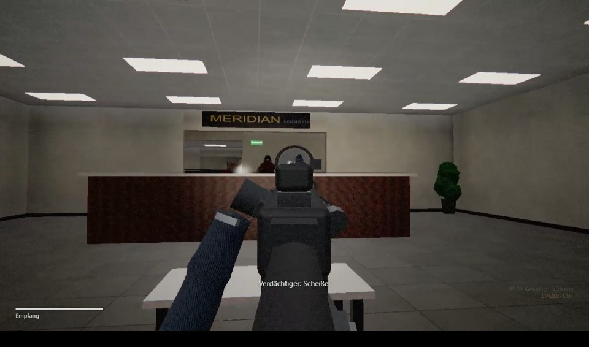
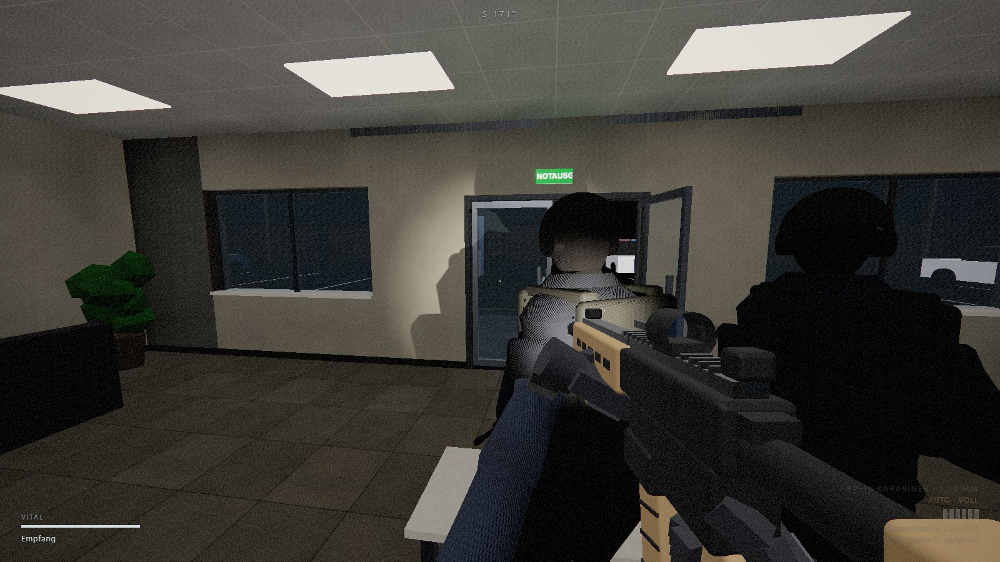
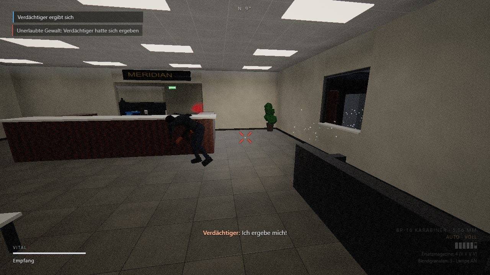

# Hotzone Breachpoint

Taktischer SWAT-Shooter für Windows, inspiriert von *Ready or Not*. Ein dreiköpfiges Einsatzteam räumt ein besetztes Bürogebäude Raum für Raum: Verdächtige anrufen, festnehmen oder ausschalten, Geiseln befreien, Beweise sichern. Wer auf Ergebene schießt, verstößt gegen die Einsatzregeln.

[](docs/media/gameplay.mp4)
*Gameplay-Video (2 Minuten): Bild anklicken.*

| | |
|---|---|
|  |  |
|  |  |
|  |  |
|  |  |

Download: [Releases](../../releases/latest)

## Wie das Spiel funktioniert

**Gunplay:** Rückstoß und Waffenschwanken sind als Federsysteme umgesetzt, gezielt wird über das Rotpunktvisier. Magazine werden einzeln verwaltet; der Spieler sieht nur eine Füllstand-Schätzung. Kugeln durchschlagen Trockenbau, Holz, Glas und Stellwände, aber keinen Beton. Glas zerbricht und ist danach durchlässig. Treffer werden mit Hitmarker und Treffergeräusch bestätigt.

**Bewegung:** Lehnen um Ecken mit Kollisionsprüfung, Ducken, Schleichen, Sprinten mit Ausdauer, träges Beschleunigen. Schrittgeräusche hängen vom Boden ab und sind für die KI hörbar.

**Gegner-KI:** Wahrnehmung über Sichtkegel, Lichtverhältnisse und Gehör; die Reaktionszeit hängt von Entfernung und Können ab. Gegner suchen Deckung, tauchen zum Schießen auf, halten Winkel oder rücken vor (höchstens zwei gleichzeitig), weichen aus der Schusslinie und schießen nicht durch eigene Leute oder Geiseln. Auf Anruf ergeben sie sich, je nach Moral, Verletzung und Lage. Manche täuschen das Aufgeben nur vor.

**Team:** Zwei KI-Kollegen (Alpha 2 und 3) folgen in Formation oder halten auf Befehl Position. Sie rufen Verdächtige an, bevor sie schießen, bekämpfen Bedrohungen, nehmen Ergebene fest und melden über Funk Kontakte, Abschüsse, Geiseln, Festnahmen und geräumte Räume. Die Einsatzleitung meldet sich mit eigener Stimme.

**Aktive Ragdolls (Euphoria-Prinzip):** Getroffene versuchen, das Gleichgewicht zu halten. Sie setzen Ausfallschritte zum Kipp-Punkt ihres Schwerpunkts, krümmen sich um die Wunde und greifen danach, während der freie Arm rudert. Mit nachlassender Muskelkraft knicken die Knie ein, der Sturz wird mit den Händen abgefangen, am Boden krümmen sie sich noch kurz. Kopftreffer führen zum sofortigen Zusammensacken.

**Figuren:** Durchgehende, verformbare Körper (Skinning) mit Kleidung, Kapuze oder Sturmhaube, Schutzweste mit Taschen, Holster und Stiefeln. Lebende Pose und Ragdoll nutzen dieselben Gelenke.

**Taktik:** Türen öffnen, langsam aufschieben (Mausrad) oder eintreten. Blendgranaten blenden und betäuben, auch den Spieler selbst. Fällt der Spieler, rückt Verstärkung am Eingang nach; das fließt in die Bewertung ein.

**Grafik und Ton:** Beleuchtung wird beim Laden vorberechnet (Schatten je Leuchte, Raumfüllung, Ecken-Abdunklung, Mondlicht durch Fenster), dazu eine Waffenlampe mit Echtzeitschatten. Texturen, Modelle und Sounds entstehen prozedural im Code; es gibt keine externen Assets. Die Sprachausgabe nutzt die Windows-Stimmen, mit eigener Funkstimme.

## Steuerung

| Taste | Aktion |
|---|---|
| WASD · Shift · Alt | Bewegen · Sprinten · Schleichen |
| Strg (halten) / C | Ducken |
| Q / E | Lehnen |
| Linke / rechte Maustaste | Schießen / Zielen |
| R · B · T | Nachladen · Feuermodus · Waffenlampe |
| 1 / 2 · G | Karabiner / Pistole · Blendgranate |
| F tippen / halten | Rufen bzw. Tür · Festnehmen, Geisel befreien, Beweis sichern |
| Mausrad · V | Tür langsam öffnen · Tür eintreten |
| H | Team: Position halten / folgen |
| Tab · Esc · F11 · F3 | Einsatzziele · Pause · Vollbild · FPS |

## Technik

Three.js (WebGL), gebündelt mit Vite. Das Windows-Release ist ein kleiner eigener Launcher (C#, .NET Framework 4), der das Spiel in einem Programmfenster über die in Windows enthaltene WebView2-Komponente darstellt.

```bash
npm install
npm run dev      # Entwicklung unter http://localhost:5180
npm run pack     # Windows-Release nach release/
```

| Ordner | Inhalt |
|---|---|
| `src/world` | Karte, Kollision, Licht-Baking, Navigation, Türen |
| `src/actors` | Skelett und IK, verformbare Körper, aktive Ragdoll, KI, Waffenmodelle |
| `src/player` | Steuerung, Waffenmodell mit Händen und Animationen |
| `src/fx` | Partikel, Einschüsse, Nachbearbeitung |
| `src/engine` | Texturen, Materialien, Audio, Sprache, Eingabe |
| `launcher/` | Windows-Launcher |
